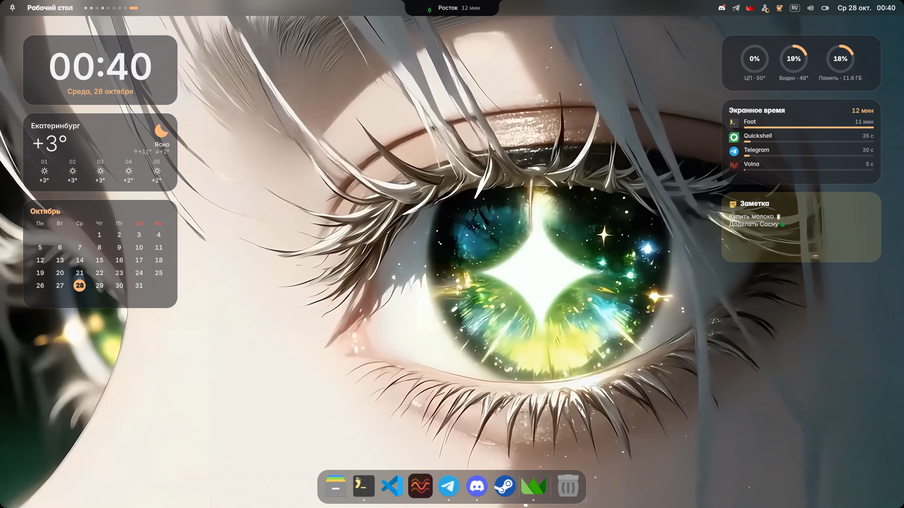
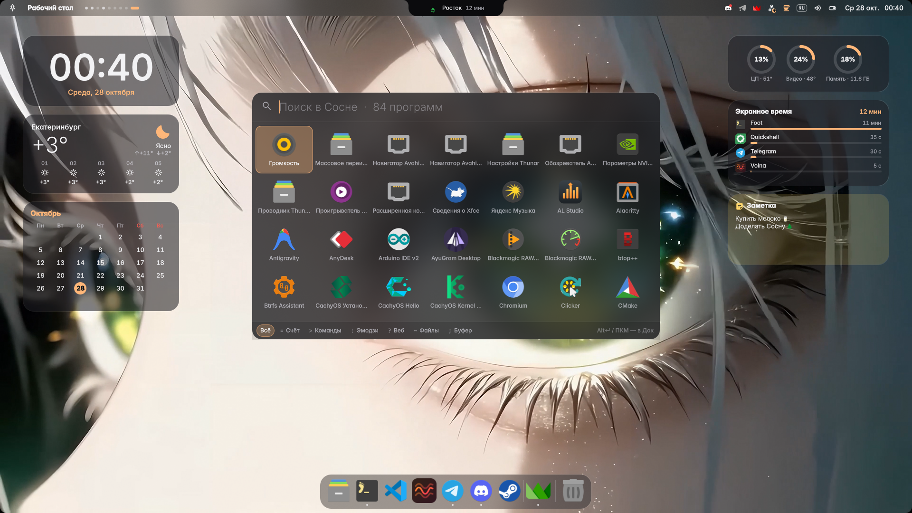
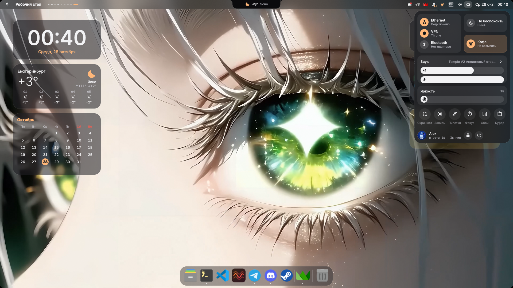
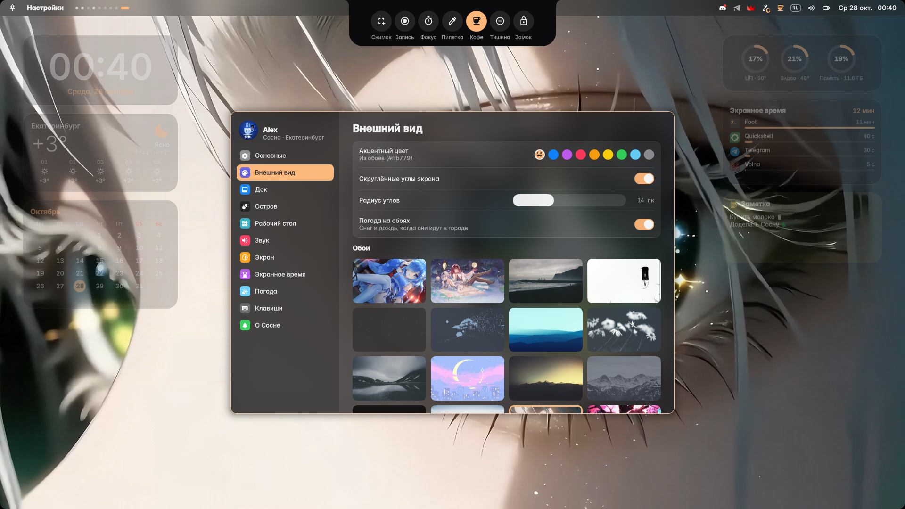
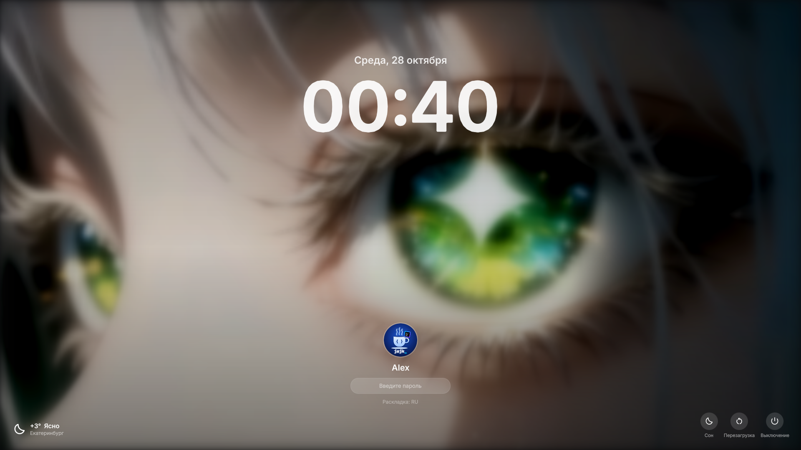
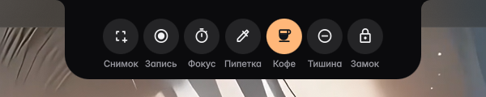

# 🌲 Сосна

**Сосна** — оболочка рабочего стола в духе macOS для [Hyprland](https://hypr.land) на [Quickshell](https://quickshell.org).
Строка меню, Dynamic Island, док с увеличением, Spotlight, Центр управления, Mission Control, экран блокировки, виджеты и собственное приложение «Настройки», и всё в цветах ваших обоев.



| Spotlight и Launchpad | Центр управления |
|---|---|
|  |  |
| **Настройки** | **Экран блокировки** |
|  |  |

## Что умеет

- **Строка меню**: меню 🌲, активное приложение, трей, сеть и кабель, звук, погода, часы. По клику открываются всплывающие окна в стиле macOS.
- **Остров (Dynamic Island)**:
  - играющая музыка с обложкой и визуализатором;
  - **синхронный текст песни** с [LRCLIB](https://lrclib.net) с караоке-заливкой строки;
  - громкость, яркость, раскладка, Caps Lock, уведомления, запись экрана, режим фокуса;
  - в покое показывает погоду и сосенку;
  - **Claude Code**: пока он работает, в острове видно, что он делает («Читает Media.qml», «Выполняет: git status») и сколько токенов занято. Клик разворачивает **чат**: можно написать Claude прямо из острова (см. [ниже](#claude-code-в-острове));
  - на долгое нажатие открывает быстрые действия: снимок, запись, фокус, пипетка, «кофе» (не засыпать), тишина, замок.

  
- **Док**: увеличение при наведении, автоскрытие, точки запущенных программ, папки «Загрузки», свои папки и корзина. Значок вытягивается вверх и пропадает с облачком «пуф». Файлы можно перетаскивать на значки.
- **Spotlight** (одиночное нажатие Win): программы с историей запусков, калькулятор (qalc), команды, эмодзи с русскими названиями, файлы, история буфера обмена с картинками, поиск в интернете. Русская раскладка понимается как английская. С пустым запросом показывает все программы сеткой, как Launchpad.
- **Центр управления**: Wi-Fi и кабель, Bluetooth, громкость, яркость монитора по DDC/CI, плеер. Устройства вывода и ввода выбираются в разделе «Звук».
- **Mission Control** (Win+Tab) и **переключатель окон** (Alt+Tab).
- **Скриншоты как на маке**: экран замирает, дальше выделяете область или кликаете по окну. В углу появляется миниатюра, по клику она открывается для правки в satty. Снимок сразу копируется в буфер.
- **Рабочий стол**: виджеты часов, календаря, погоды, музыки, системы, заметки и экранного времени (перетаскиваются мышью), снег и дождь по реальной погоде.
- **Экран блокировки** с размытыми обоями и входом по паролю через PAM.
- **Цвета из обоев** через matugen. Под них подстраиваются акцент, рамки окон и **цвета терминала** (включая fastfetch и `ls`).
- **Мелочи**: скруглённые углы экрана, горячий угол, «встряхни мышь, чтобы найти курсор», звуки системы, экранное время по приложениям, отсчёт до события (например, до Нового года).

## Установка на чистую систему

Нужен **Arch Linux** или производный дистрибутив (CachyOS, EndeavourOS, …) и **Hyprland 0.56+** с Lua-конфигом.

### 1. Система

Если Arch ставится с нуля, проще всего взять `archinstall` и выбрать профиль **Minimal** (или сразу *Desktop → Hyprland*). Сеть — NetworkManager, звук — PipeWire. После перезагрузки войдите под своим пользователем в TTY.

### 2. Git и репозиторий

```sh
sudo pacman -S --needed git
git clone https://github.com/picun7977-cell/sosna.git ~/sosna
cd ~/sosna
```

### 3. Установщик

```sh
./install.sh
```

Что делает установщик:
1. Ставит пакеты из официальных репозиториев (`hyprland`, `quickshell`, `matugen`, `cava`, `cliphist`, `grim`, `satty`, `gpu-screen-recorder`, `ddcutil`, шрифты Inter и Material Symbols, значки Papirus…). `mpvpaper` для живых обоев ставится, если доступен.
2. Копирует оболочку в `~/.config/quickshell/sosna` и скрипт запуска в `~/.local/bin/sosna-start`.
3. Кладёт `~/.config/hypr/sosna.lua` и подключает его строкой `require("sosna")`. Если своего конфига Hyprland нет, ставит готовый минимальный `hyprland.lua`.
4. Скачивает курсор [Bibata Modern Classic](https://github.com/ful1e5/Bibata_Cursor).
5. Создаёт `~/Wallpapers` и `~/Pictures/Screenshots` и подключает цвета терминала к fish и bash.

Если какой-то файл уже был, он не затирается, а сохраняется рядом с припиской `.bak-дата`.

Параметры: `--no-deps` пропускает установку пакетов, `--link` ставит ссылку на папку репозитория вместо копии (удобно для разработки).

### 4. Обои и первый запуск

```sh
cp ваши-картинки.jpg ~/Wallpapers/
Hyprland          # если вы в TTY; или выберите Hyprland в экранном менеджере
```

Оболочка запускается сама. Выбрать обои: **Win+,** → «Внешний вид». Город для погоды задаётся в разделе «Погода».

> Живые обои: положите видео рядом с картинкой под тем же именем (`лес.jpg` + `лес.mp4`), и при наличии `mpvpaper` будет играть видео.

## Горячие клавиши

| Клавиши | Действие |
|---|---|
| **Win** (нажать и отпустить) | Spotlight |
| Win+Space | Spotlight |
| Win+V | История буфера обмена |
| Win+. | Эмодзи |
| Win+K | Центр управления |
| Win+B | Уведомления |
| Win+Tab | Mission Control |
| Alt+Tab / Shift+Alt+Tab | Переключение окон |
| Win+, | Настройки Сосны |
| Ctrl+Alt+V | Звук |
| Win+L | Заблокировать |
| Ctrl+Alt+Delete | Меню выключения |
| Win+Shift+S | Скриншот области или окна |
| Print | Скриншот всего экрана |
| Win+Shift+C | Пипетка |
| Win+Alt+R | Запись экрана |
| Win+F1 / Win+F2 | Яркость монитора − / + |
| Ctrl+Win+Space, Ctrl+Win+= / − | Пауза, следующий и предыдущий трек |
| Ctrl+Win+Alt+R | Перезапустить оболочку |

В готовом `hyprland.lua` есть ещё: Win+T терминал, Win+E файлы, Win+C/Win+Q закрыть окно, Win+F полный экран, Win+1…9 рабочие столы, Win+Alt+1…9 перенести окно, Alt+Shift раскладка.

## Настройки

Почти всё настраивается в приложении **«Настройки Сосны»** (Win+,): имя и аватар, акцентный цвет, скругления, док, остров, виджеты, звук, яркость, экранное время, погода.

Настройки лежат в `~/.config/sosna/settings.json`. Файл можно править руками, изменения подхватываются на лету.

Другие программы могут управлять оболочкой через IPC:

```sh
qs -c sosna ipc call island show "Сборка" "Готово ✅"   # сообщение в острове
qs -c sosna ipc call shot area                          # скриншот области
qs -c sosna ipc call brightness set 60                  # яркость монитора
qs -c sosna ipc call ui settings sound                  # открыть Настройки на разделе «Звук»
```

## Claude Code в острове

В `extras/claude-code/task-notify` лежит мод для [Claude Code](https://claude.com/claude-code). Пока Claude работает, а музыка не играет, остров показывает:
- оранжевую звёздочку;
- текущее действие;
- число токенов в контексте.

Клик по острову открывает чат: там ваши запросы и ответы Claude, а написанное в поле ввода уходит в открытую сессию как обычный запрос. Ещё мод присылает уведомление со звуком в конце хода и показывает полоску заполненности контекста в строке подсказок.

```sh
mkdir -p ~/.claude/mods
cp -r extras/claude-code/task-notify ~/.claude/mods/
```

Затем в `~/.claude/settings.json` добавьте (если блок `env` уже есть, допишите строку в него):

```json
{ "env": { "CLAUDE_CODE_PLUGIN_DIRS": "~/.claude/mods/task-notify" } }
```

и перезапустите Claude Code.

## Если что-то не работает

- **Лог оболочки:** `~/.cache/sosna/qs.log`. Перезапуск: `qs -c sosna kill; sosna-start`.
- **Ошибки в конфиге Hyprland:** `Hyprland --verify-config`.
- **Не меняется яркость:** монитор должен поддерживать DDC/CI (включается в меню монитора), а пользователь должен состоять в группе `i2c`. После установки перезайдите.
- **Нет текста песни:** такой песни нет на LRCLIB, или плеер не передаёт исполнителя и название по MPRIS.
- **Терминал не в цветах обоев:** откройте новый терминал. Цвета записываются в `~/.local/state/sosna/sequences.txt` при смене обоев.

## Удаление

```sh
cd ~/sosna
./uninstall.sh            # оболочка удаляется, настройки остаются
./uninstall.sh --purge    # удаляются и настройки, кэш, экранное время
```

Пакеты и курсор при этом не удаляются. Строка `require("sosna")` убирается из `hyprland.lua`.

## Лицензия

[GPL-3.0](LICENSE). Список эмодзи (`assets/emojis.txt`) взят из [caelestia-shell](https://github.com/caelestia-dots/shell) (GPL-3.0), курсор — [Bibata](https://github.com/ful1e5/Bibata_Cursor), погода — [Open-Meteo](https://open-meteo.com), тексты песен — [LRCLIB](https://lrclib.net).
